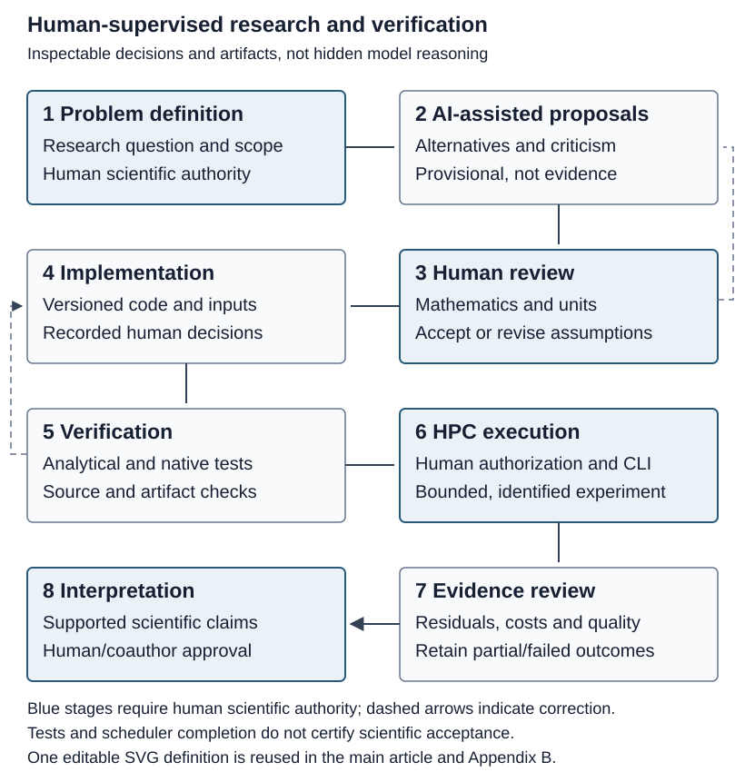

# Scope and conceptual framework

This appendix documents the observable research process rather than language
models' hidden reasoning. A scientific decision trail links questions and
assumptions to alternatives, human intervention, implementation, verification
and the evidence actually retained. The principal contribution of the article
remains computational scalability of grain-storage network MILPs. Human–AI
methodology is complementary and is not a controlled productivity experiment.

The supplied21 October2026 Subgroup1 meeting excerpt explicitly requests this
methodological account in Agreement5 and sections8/10. It asks researchers to
document tools, human supervision, limitations and the scientific/computational
decision trail while preserving the central investigation. The excerpt contains
Agreement5 and sections8–11, not the complete minutes. Its source identity and
editorial crosswalk are retained in the repository's source assessment.[^meeting]

[^meeting]: https://github.com/unb-lamfo-or-ai-hpc/model-agrologistic/blob/docs/s6a-coauthor-review/docs/s6a_20261021/meeting_and_source_review.md

# Tools and research roles

Gurobot, Gemini and GPT systems provided technical proposals and scientific
discussion. ChatGPT Classic supported coordination and editorial decisions;
Codex supported implementation, tests, diagnostics and documentation. GitHub is
the persistent technical record, not an AI system. Python is the implementation
language; Gurobi and SCIP/SoPlex are optimization tools; NPAD and Slurm provide
computational infrastructure and scheduling. Human researchers decide what is
scientifically admissible, execute cluster commands and accept evidence.

# Historical modeling assistance

The source is the researcher-supplied *Expanded Summary: Use of Gurobot in
Research Development*, DOCX SHA256
21735cebc3385dadd67c8ebc07c41b310a239bd9f4c9b91b3783c7f89820d1a3.
Gurobot generated this retrospective account. It is not a preserved transcript,
timestamped native log or independent verification of its numerical claims.
The researcher supplied the account as historical guidance; detailed original
execution records are not supplied with it. Activities occurred
partly in parallel with the modeling associated with Rosa (2026), whose
mathematical contribution remains appropriately attributed.

| Phase | Retrospectively reported activity | Evidence qualification and current boundary |
| --- | --- | --- |
| A Initial formulation and synthetic validation | Natural-language formulation, DET/STO structure, gurobipy and a two-origin/three-hub/two-destination/two-product/three-period/three-scenario example; 513 variables and 261 constraints reported | Historical reported counts, not independently reproduced here. DET singleton specialization is separately tested in the current scalar code |
| B Expansion and modernization | Discussion of investment activation, capacities, simultaneity, budgets and operational feasibility | Exploratory proposals are not all implemented. Current eligibility, exclusion and handling-capacity rules govern the active model; no new budget constraint is introduced |
| C Extended GAMS | Analysis/translation of agroSC-S3.gms, export outlets and a revenue-oriented objective; 1,710 variables and 936 constraints reported | Historical source/example claims. The approved scalar objective does not acquire an export-revenue term from this episode |
| D Pyomo translation | Interpretation of the Rosa-related specification, native gurobipy construction, Excel ingestion and smoke tests | Mathematical attribution is retained. Historical Haversine substitution and information-value calculations are not current OSRM/scalar methodology |
| E Exploratory Benders | Classical and callback-based implementations, cut/bound/index corrections, warm starts and reported numerical agreement | Retrospective exploration, not reproduced evidence. Decomposition implementation, derivation and benchmarking are outside active MVP2; the episode only illustrates scope decisions |

For each phase, distinguish researcher-attested consultation, AI retrospective,
available source files, verified execution and current functionality. Do not
promote reported synthetic optimality, a claimed sandbox run or a retrospective
correction into independent experimental evidence. No historical dates, model
versions or unavailable conversation text are reconstructed.

# Organization of subsequent AI assistance

Gemini/GPT supported mathematical discussion, criticism, code and experimental
planning. Multiple assistants discussing an issue are not statistically
independent reviewers. ChatGPT Classic organized research objectives,
interpretation and portfolio/editorial decisions. Codex developed Python,
solver integration, tests, GitHub changes, HPC scripts and evidence handling
within human-approved scope. Conversation history can explain why a proposal
was considered; it cannot certify a numerical result. Neither commit author
names nor passing CI identify which person or assistant independently authored
every code line.

# Human–AI research workflow

{#fig-human-ai-appendix}

Problem definition and AI-assisted proposals precede human scientific evaluation.
Version-controlled implementation is followed by mathematical/software tests.
Human-authorized HPC execution produces solver and resource records, which
undergo independent evidence review before interpretation. Corrections can
return to assumptions, implementation or experiment design. These loops do not
authorize an assistant to change a model, launch a new optimization or approve
publication. One authoritative figure definition serves both placements.

# Scientific decision provenance

| Decision and date | Scientific issue and AI-assisted proposal | Human intervention | Implementation and verification | Evidentiary outcome |
| --- | --- | --- | --- | --- |
| Economic-cost audit, September 2026 | Cost accounting and the relation of quantities to investment charges | Researcher requested correction and explicit modeling policy | Audit/correction records in PR12–13; original results retain their own source identities | Documentary correction episode, not proof of every later result.[^cost-prs] |
| HPC containment, October 2026 | An initially strong execution-isolation design met unavailable host capabilities | Researcher retained academic traceability but rejected unnecessary production qualification | Diagnostic failures preserved; proportional academic profile in PR99 | Negative operational evidence informed simplification, not a claim that unavailable isolation was certified.[^academic] |
| Scalar restoration, 19 October 2026 | Earlier hierarchy did not express the approved economic comparison | Researcher required a single scalar objective and excluded EVPI/VSS | PR112; analytical/native tests check investment once, separate penalties and singleton equivalence | Software qualification is separate from later large-instance success.[^scalar] |
| Fixed penalties, 20 October 2026 | Calibration was proposed because large slack penalties dominate the total | Researcher rejected calibration as a prerequisite and retained 90000/45000/45000 | Accepted h215 original certificates and later unchanged effective-rate guards | Success means the approved scalar contract, not no-slack infrastructure adequacy.[^h215] |
| Population lineage, 20 October 2026 | A guessed h300 path and an inapplicable checkpoint interpretation stopped preparation | Researcher supplied historical file/hash/ranking records | PR118–119; actual membership, original ranking and materialization provenance checked | Preserved failed bootstraps; no resampling or silent certificate rewrite.[^population] |
| Scale progression, 21 October 2026 | Select a bounded h400 candidate from descriptive h300 evidence, then assess h500 | Researcher approved separate envelopes and prospective eligibility | PR121–123; original h400 residual/quality/resource gate and h500 package | h400 is accepted; h500 job2220382 is RUNNING, not a completed scientific result.[^scale] |
| Editorial redirection, 21 October 2026 | Earlier proposal offered two questions and a narrow representative case | Researcher approved one question, cross-scale agricultural interpretation, complete Appendix A and complementary Human–AI method | This PR120 revision, notation/code audit and proportional documentation/geographic tests | Editorial preparation awaiting coauthor review, not journal submission.[^editorial] |

Dates above refer to documented decision records or explicitly stated months,
not invented timestamps of private conversations. The full matrix may retain
exact technical references; the main article uses the consolidated history
rather than an administrative catalogue of individual PRs.

[^cost-prs]: https://github.com/unb-lamfo-or-ai-hpc/model-agrologistic/pull/12 and https://github.com/unb-lamfo-or-ai-hpc/model-agrologistic/pull/13
[^academic]: https://github.com/unb-lamfo-or-ai-hpc/model-agrologistic/pull/99
[^scalar]: https://github.com/unb-lamfo-or-ai-hpc/model-agrologistic/pull/112
[^h215]: https://github.com/unb-lamfo-or-ai-hpc/model-agrologistic/pull/115
[^population]: https://github.com/unb-lamfo-or-ai-hpc/model-agrologistic/pull/118 and https://github.com/unb-lamfo-or-ai-hpc/model-agrologistic/pull/119
[^scale]: https://github.com/unb-lamfo-or-ai-hpc/model-agrologistic/pull/121 and https://github.com/unb-lamfo-or-ai-hpc/model-agrologistic/pull/122 and https://github.com/unb-lamfo-or-ai-hpc/model-agrologistic/pull/123
[^editorial]: https://github.com/unb-lamfo-or-ai-hpc/model-agrologistic/pull/120

# GitHub development history

Representative corrections matter because they expose the distinction between
a proposed method, a human decision and numerical evidence. The repository
records failed admissions and revisions as well as successful tests and solves.
The earlier hierarchical S2 closure is historical, not a scalar result.[^s2]
Original claims and certificates are preserved at their original sources.
The consolidated closed-PR history provides the wider technical record.[^all]

[^s2]: https://github.com/unb-lamfo-or-ai-hpc/model-agrologistic/pull/110
[^all]: https://github.com/unb-lamfo-or-ai-hpc/model-agrologistic/pulls?q=is%3Apr+state%3Aclosed

# Human supervision mechanisms

Conceptual supervision controls the research question and scope. Mathematical
supervision checks units, indexing, stages and objective correspondence.
Computational supervision reviews implementation and analytical/native tests.
Experimental supervision approves bounded resources and preserves execution
identities. Scientific acceptance checks the actual returned evidence, not
only scheduler completion. Editorial supervision connects supported findings to
claims and requires coauthor review. Formal authorship/CRediT assignments are
not made by this methodological account.

# Reproducibility

Every reported experiment retains its source, input, population, configuration,
runtime, solver, original validation and terminal identities. Read-only portable
replay verifies retained certificates; it is not a private-input re-solve.
Figures inherit accepted case identities and explicit filters. A separate local
geographic SQLite repository caches source-bound entities and road geometry;
viewing and rendering do not mutate data or contact OSRM. Restricted coordinates
and row-level outputs remain external when disclosure is not established.

# Limitations

Conversation records are incomplete, retrospective summaries can be mistaken,
language-model outputs are nondeterministic, and internal reasoning is not
available for audit. Shared records do not imply independent AI review or
complete authorship attribution. Private inputs and absent route geometries can
limit reproduction of particular figures. There is no counterfactual study of
AI productivity or guaranteed error reduction. These limitations do not replace
the requirement for mathematical correctness and original numerical validation;
they define what this complementary methodological contribution can support.
