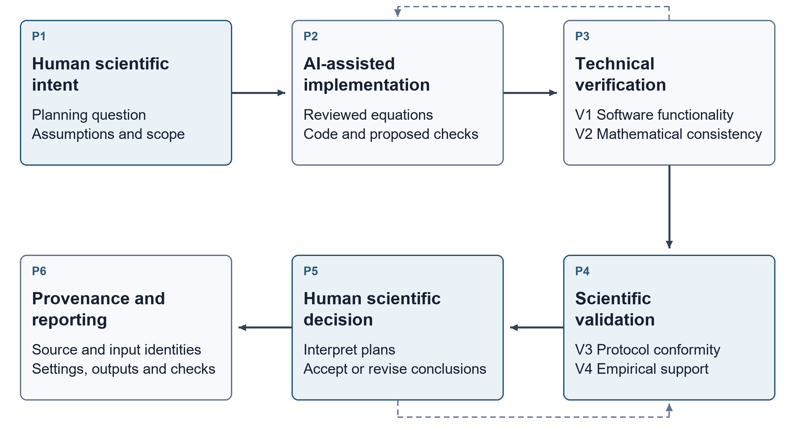

# Appendix A — Systematic Literature Review of Grain Facility-Location Models

::: {.content-visible when-format="html"}

[Read or download the complete Appendix A PDF](appendix_a_original.pdf).

<object data="appendix_a_original.pdf" type="application/pdf" width="100%" height="900">
The complete PDF is available using the download link above.
</object>

:::

::: {.content-visible when-format="pdf"}

```{=latex}
\includepdf[pages=-,pagecommand={\thispagestyle{empty}},fitpaper=true]{appendix_a_original.pdf}
```

:::

# Appendix B Human-supervised AI-assisted research

## B1 Purpose and scope

AI assistants supported the development of this work through mathematical
discussion, implementation, technical criticism and scientific writing.
Human researchers defined the planning problem, selected assumptions and
experimental configurations, reviewed proposed changes and interpreted the
resulting investment and operating decisions. This appendix explains how those
activities were connected through mathematical review and computational
verification.

The procedure follows six phases: Human Scientific Intent, AI-Assisted
Implementation, Technical Verification, Scientific Validation, Human Scientific
Decision, and Provenance/Reporting. Section B3 explains these phases through
examples from the shared-investment stochastic model; Section B4 distinguishes
the four levels of verification used to assess the work.

## B2 Tools and human responsibilities

Gurobot was used for formulation and implementation discussions. Gemini and
GPT systems supported technical criticism and alternative interpretations.
ChatGPT Classic supported coordination and writing, while Codex supported
Python implementation, tests, diagnostics and documentation. Researchers
reviewed the proposed changes and decided which ones to adopt.

The numerical tools had distinct roles. Python organized the data and
calculations. Gurobi and SCIP provided native mathematical-programming
implementations, while Pyomo expressed a common algebraic formulation for
Gurobi, SCIP and HiGHS interfaces. GitHub retained versioned source and
experiment records, and Slurm scheduled the HPC calculations. Researchers
executed the experimental commands and assessed their outputs.

## B3 From the scientific question to a computational result

The six phases connect a planning question to an implemented and interpreted
experiment. Table B.1 illustrates their application to the two-stage model.
A discrepancy found during verification returns the work to the relevant
assumption or implementation.

| Phase | Research activity | Example from this work |
| --- | --- | --- |
| P1 Human Scientific Intent | Define the planning question, decisions and assumptions | Locate and size storage facilities before uncertain supply and demand are realized |
| P2 AI-Assisted Implementation | Translate reviewed equations into code and propose checks | Represent common investment decisions and scenario-dependent grain flows |
| P3 Technical Verification | Check executable behavior and mathematical properties | Verify that investment is charged once and operating costs are probability weighted |
| P4 Scientific Validation | Examine whether experiments address the question and how their outputs should be interpreted | Assess feasibility, objective bounds, resources and agricultural service jointly |
| P5 Human Scientific Decision | Accept, revise or reject interpretations and methodological changes | Interpret penalized plans using unmet demand and storage/handling indicators |
| P6 Provenance/Reporting | Associate reported results with their implemented experiment | Retain the source, input, scenario, solver and validation records for each result |

: Research phases and their application.

The example distinguishes a shared investment from repeated recourse decisions.
A capacity investment is made once, before the scenario is known. Each
scenario then has its own flow, inventory and shortage decisions. Consequently,
scenario probabilities weight operating costs, while investment enters the
objective once and physical balances retain their original units.

## B4 Four levels of verification

The workflow in Figure B.1 links the research phases to repeated review and
verification. A proposed change is examined at the levels appropriate to its
effect on the scientific calculation.



The return arrows represent revision after a discrepancy is identified.
For example, a successful program is followed by checks of investment
accounting and probability weights, and then by examination of original-unit
balances and the agricultural meaning of the returned plan. Table B.2
distinguishes these complementary levels.

| Level | Question examined | Evidence used in this work |
| --- | --- | --- |
| V1 Software functionality | Does the intended operation execute and return the required products? | Data-loading, model-construction and output tests |
| V2 Mathematical consistency | Does the implementation express the reviewed equations and units? | Analytical examples, deterministic specialization, investment accounting and objective reconstruction |
| V3 Protocol conformity | Was the specified instance and experimental configuration used? | Source/input identities, scenario membership, solver settings and resource records |
| V4 Empirical scientific support | What conclusions do the observed decisions and resources support? | Accepted original residual checks, objective bounds, service/capacity indicators and qualified interpretation |

: Complementary levels of verification.

Small examples examined investment charged once, probability weighting,
capacity units and activation conditions. Large-instance outputs were checked
against material balances, eligibility and capacity relationships in their
original units, with all fourteen objective components reconstructed
separately. These checks support different conclusions: the relative gap
quantifies uncertainty about the scalar objective, while service and
capacity indicators explain the physical consequences of the plan.

## B5 Traceability of a computational result

For each experiment, the retained record identifies the source version,
input workbook, facility population, scenario design, solver settings,
resource limits, decisions and validation outcome. This association permits
another researcher to connect a numerical table to the calculation that
produced it. Partial and failed attempts are retained alongside successful
ones to avoid selective reporting.

The [mathematical contract](https://github.com/unb-lamfo-or-ai-hpc/model-agrologistic/blob/1b54023f4e0c0c27aba64883b1e9cf25817ad0f8/docs/mvp2_scalar_contract.md),
[implementation](https://github.com/unb-lamfo-or-ai-hpc/model-agrologistic/blob/1b54023f4e0c0c27aba64883b1e9cf25817ad0f8/src/logic/optimization_gurobipy_stochastic.py) and
[independent validator](https://github.com/unb-lamfo-or-ai-hpc/model-agrologistic/blob/1b54023f4e0c0c27aba64883b1e9cf25817ad0f8/src/logic/solution_validation.py)
provide a concrete route from assumptions to checked decisions. For example,
the [h500 experiment record](https://github.com/unb-lamfo-or-ai-hpc/model-agrologistic/blob/1b54023f4e0c0c27aba64883b1e9cf25817ad0f8/docs/evidence/scalar_h500_2220382_review.json)
connects its input and source identities to the objective, bound, original
validation and resource observations. Appendices C and D explain the
corresponding implementation and data.

An integrity replay checks consistency of retained records and their hashes.
It does not rerun the optimizer or recompute residuals against unavailable
inputs. A fresh numerical reproduction must generate new decisions and apply
the independent validation procedure to them.

## B6 Limitations

The conversational record is incomplete. Different assistants may repeat a
common error, so agreement between them is not independent scientific review.
Tests verify specified properties and examples; they do not establish general
correctness or substitute for substantive modeling judgment. Restricted inputs
can also limit independent reconstruction of a large experiment.

The study has no controlled comparison for measuring time saved, productivity
or error reductions caused by AI assistance. Its methodological contribution
is the inspectable connection between proposals, human decisions,
implementations and numerical evidence. The authors retain responsibility for
all assumptions, reported results and conclusions.




